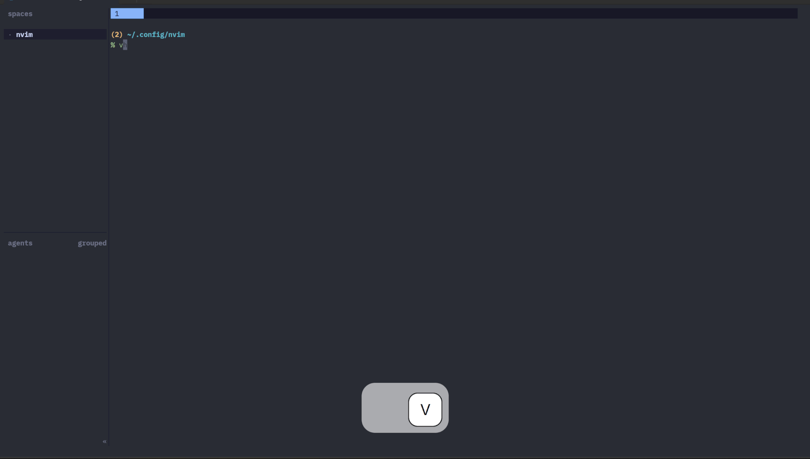

# omp.nvim

Neovim plugin that talks to the [omp](https://omp.sh/) agent running in your current directory — without leaving your editor.



## ⭐ Motivation

ACP treats OMP as a simple prompt endpoint. As a result, many of OMP's interactive capabilities are inaccessible from Neovim, forcing users to switch back to the terminal for common tasks like changing models or toggling runtime features.

Rather than being another AI chat plugin, this project focuses on exposing OMP itself inside Neovim.

## ✨ Features

- Inject prompts into the omp session running in the current directory
- `@this` / `@buffer` placeholders resolved to inlined, fenced editor context
- Send the current line, a visual selection, or any `:range` of the file
- Interactive prompt with Enter-to-submit, Esc-to-discard
- Zero-config bridge extension, auto-installed and auto-discovered by omp
- Files omp changes are reloaded automatically when a turn ends
- Simple, sensible, Vim-y defaults

## 📦 Setup

Requires Neovim 0.11+ (uses `vim.uv` pipe transport; the recommended `vim.pack` setup needs 0.11).

[vim.pack](https://neovim.io/doc/user/pack/#vim.pack) (recommended)

```lua
-- Disable the default <leader>oa maps and bind your own (flag before add)
vim.g.omp_nvim_no_keymaps = true
vim.keymap.set("n", "<leader>om", "<Cmd>OmpAsk<CR>", { desc = "omp: ask" })
vim.keymap.set("x", "<leader>om", function()
  require("omp_nvim").ask()
end, { desc = "omp: ask selection" })

vim.pack.add({
  {
    src = "https://github.com/l3aro/omp.nvim",
    version = vim.version.range("*"), -- Latest stable release
  },
})
```

<details>
<summary><a href="https://github.com/folke/lazy.nvim">lazy.nvim</a></summary>

```lua
{
  "l3aro/omp.nvim",
  version = "*", -- Latest stable release
  -- Disable the default <leader>oa maps; init runs before the plugin loads
  init = function()
    vim.g.omp_nvim_no_keymaps = true
  end,
  keys = {
    { "<leader>om", "<Cmd>OmpAsk<CR>", desc = "omp: ask" },
    { "<leader>om", function()
      require("omp_nvim").ask()
    end, mode = "x", desc = "omp: ask selection" },
  },
}
```

</details>

> [!TIP]
> Run `:checkhealth omp_nvim` after setup.

## 🔌 Bridge extension

`setup()` auto-installs the bridge to `~/.omp/agent/extensions/omp-nvim-bridge.ts`, where every omp discovers it at startup. You normally never touch it, but reinstall (or repair) anytime:

```vim
:OmpNvimInstallExtension
```

Without nvim:

```bash
cp <repo>/extension/omp-nvim-bridge.ts ~/.omp/agent/extensions/omp-nvim-bridge.ts
```

> [!IMPORTANT]
> Restart omp after (re)installing — extensions are only picked up at process start.

## 🚀 Usage

### Ask — `:OmpAsk` / `<leader>oa`

Send a prompt to the omp in this directory.

| Form            | Sends                                                     |
| --------------- | --------------------------------------------------------- |
| `:OmpAsk`       | Floating dialog; Enter submits, Esc discards              |
| `:OmpAsk text`  | The prompt as given                                       |
| `:5,20OmpAsk`   | Lines 5–20 of the current file as context                 |
| `:%OmpAsk`      | The whole file as context                                 |
| `:'<,'>OmpAsk`  | The last visual range                                     |
| `<leader>oa` (n)| Dialog ask with `@this`/`@buffer` resolved                |
| `<leader>oa` (x)| Ask about the visual selection                            |
| `<leader>oA` (n)| Same dialog, but always holds (fills omp input, waits)    |
| `<leader>oA` (x)| Hold the visual selection as a prompt                     |

**Hold mode**: `<leader>oA` (or `ask({ hold = true })`) runs the same dialog,
but Enter fills omp's input editor instead of submitting — review it there,
then press Enter in omp when you're ready.

Opt out of the default keymaps with `vim.g.omp_nvim_no_keymaps = true`.

### API

```lua
local omp = require("omp_nvim")

omp.prompt("Review the error handling here")                -- Inject a prompt verbatim (runs immediately)
omp.prompt("Review this", { submit = false })               -- Fill omp's input; press Enter there to run
omp.input_dialog("omp: ", function(text, mode) end)         -- Floating dialog; mode = "submit"|"hold"|nil
omp.send_range(5, 20, "Review these lines:")                -- Send file lines 5-20
omp.send_selection("x", "Explain this:")                    -- Send the last visual selection
omp.ask()                                                   -- Interactive ask, @this/@buffer resolved
```

### Placeholders

`@this` and `@buffer` are replaced with file references in any non-range `:OmpAsk` (interactive or not) and in `omp.ask()`:

| Placeholder | Reference                                |
| ----------- | ---------------------------------------- |
| `@this`     | `@path:start-end` of the visual range or selection, else the current file |
| `@buffer`   | The whole current file                   |

Context is sent as references (`@path:5-20`), not inlined content — the agent
reads the file itself, keeping prompts small even for big files. Buffers with
unsaved changes are snapshotted to a temp file (referenced in the prompt) so
the agent never reads stale disk content; unnamed buffers are inlined.

## 🛠 How it works

`setup()` installs the bundled bridge extension to `~/.omp/agent/extensions/omp-nvim-bridge.ts`, where every omp auto-discovers it. The extension opens a per-directory Unix socket (`~/.omp/run/omp-nvim/omp-nvim-<hash>.sock`); the plugin sends JSONL prompt frames over it, and the bridge injects them into the live session — submitting via `sendUserMessage`, or filling the input editor (waits for Enter) when the frame carries `submit: false` (see [Bridge extension](#-bridge-extension) for reinstalling).

> [!IMPORTANT]
> The omp instance must have been started (or restarted) after the extension was installed to pick it up.

## 👀 Events

The bridge streams session status back to the plugin. When a turn ends, modified files are reloaded from disk via `checktime` (buffers with local changes are protected). Status events are also exposed for your own handlers:

```lua
require("omp_nvim.bridge").on_status(function(event)
  -- "ready" | "turn_started" | "turn_ended" | "prompt_accepted"
  if event == "turn_started" then
    vim.notify("omp is working…")
  end
end)
```

## ⚙️ Configuration

omp.nvim ships with sensible defaults — there is nothing to configure for basic use. The only option today:

| Option                       | Effect                                   |
| ---------------------------- | ---------------------------------------- |
| `vim.g.omp_nvim_no_keymaps`  | Disable the default `<leader>oa` keymaps |

### Keymaps

| Default       | Mode | Effect                              |
| ------------- | ---- | ----------------------------------- |
| `<leader>oa`  | n    | Interactive ask                     |
| `<leader>oa`  | x    | Ask about the selection             |
| `<leader>oA`  | n    | Ask, then hold in omp's input       |
| `<leader>oA`  | x    | Hold the selection in omp's input   |

Opt out with `vim.g.omp_nvim_no_keymaps = true` (must be set before the plugin loads) and bind your own — see the [Setup](#-setup) snippets for vim.pack and lazy.nvim, or simply remap over the defaults with `vim.keymap.set` after plugin load.

## 📄 License

[MIT](LICENSE) © [l3aro](https://github.com/l3aro)
